<picture>
  <source media="(prefers-color-scheme: dark)" srcset="https://raw.githubusercontent.com/Aboudjem/ui-ux-suite/main/.github/assets/hero-dark.svg">
  <source media="(prefers-color-scheme: light)" srcset="https://raw.githubusercontent.com/Aboudjem/ui-ux-suite/main/.github/assets/hero-light.svg">
  
</picture>

<p align="center">
  <a href="https://github.com/Aboudjem/ui-ux-suite/actions/workflows/ci.yml"></a>
  <a href="https://www.npmjs.com/package/ui-ux-suite"></a>
  <a href="LICENSE"></a>
</p>

<p align="center"><b>English</b> · <a href="READMEs/zh-CN.md">简体中文</a> · <a href="READMEs/ja.md">日本語</a> · <a href="READMEs/es.md">Español</a> · <a href="READMEs/fr.md">Français</a></p>

<p align="center"><b>ESLint for design. It finds the exact line, the measured wrong value, and the exact fix.</b></p>

Run it in any web project. No install, no config, no key.

```bash
npx ui-ux-suite .
```

## Sample report

The report opens with the score, then the three fixes to start with, then the detail.

```text
# Design audit: 3.7/10 (Needs Work)

**Verdict:** score 3.7/10, Needs Work. 46 located findings, 8 critical.

## Fix these first

1. 9 `.swatch*` color variants fail WCAG AA contrast (worst 1.75:1) at `src/styles.css:118`. Fix: Rebuild this color set against the surface it sits on so each meets ≥ 4.5:1 (e.g. the worst, `#b5c6d7`, should be `#6d7882` or darker), or reserve ...
2. No visible keyboard focus indicator anywhere at `src/styles.css:22`. Fix: Add a focus ring to all interactive elements: `:focus-visible { outline: 2px solid var(--ring, #2563eb); outline-offset: 2px; }`.
3. Fixed 1200px width on `.layout` with 0 media queries at `src/styles.css:57`. Fix: Use `max-width: 1200px; width: 100%` and add responsive breakpoints (sm/md/lg).

**Weakest areas:** Typography System 1.5/10, Accessibility 1.6/10, Component Quality 2/10.

_Scanned 3 CSS, 1 JSX/TSX/Vue/Svelte and 1 HTML files in 0.02s on 2026-11-17T11:33:48.104Z. The detail follows._
```

This is a real run, not a mock-up. It is the top of the output of
`npx ui-ux-suite test/fixtures/planted-ux-problems`, run from a checkout of version 0.7.0.
The fixture is broken on purpose, so it scores low.

Below those lines the report lists each finding in full. One of them:

```text
### [!] Low text contrast on `.hero-subtitle`: 1.03:1
- **Where:** `src/styles.css:14` · selector `.hero-subtitle`
- **Measured:** 1.03:1 (APCA Lc 0) (needs 4.5:1)
- **Why:** Text `#fbfbfb` on `#ffffff` measures 1.03:1 (APCA Lc 0). WCAG 2.2 §1.4.3 requires ≥ 4.5:1 for normal text.
- **Impact:** Users with low vision (and most users in bright light) cannot read this text.
- **Fix:** Change `color` on `.hero-subtitle` from `#fbfbfb` to `#767676` (meets 4.5:1 on `#ffffff`), or darken further.
- **Cites:** WCAG 1.4.3 Contrast (Minimum) (AA)
```

## Install

Pick the line for your agent. Each one is a single command.

**Claude Code.** The plugin brings the 14 skills, 5 commands, 12 agents and the MCP server.

```bash
claude plugin marketplace add Aboudjem/10x
claude plugin install ui-ux-suite@10x
```

**Any other agent that reads Agent Skills** (Cursor, Codex, Gemini CLI, OpenCode, GitHub Copilot):

```bash
npx skills add Aboudjem/ui-ux-suite
```

**Any MCP client.** The server needs no key and no setup.

```bash
claude mcp add ui-ux-suite -- npx -y ui-ux-suite --mcp
```

```json
{
  "mcpServers": {
    "ui-ux-suite": { "command": "npx", "args": ["-y", "ui-ux-suite", "--mcp"] }
  }
}
```

**No agent at all.** The command line needs no install step: `npx ui-ux-suite .` runs it.

### Works with

Each row is a real install and check, run on the date shown on macOS with Node 22.

| Agent | How it was installed | Tested | What the test showed |
|:--|:--|:--|:--|
| Claude Code | Plugin loaded with `claude --plugin-dir .` | 2026-11-17 | `claude plugin validate . --strict` passes, and the MCP server connects |
| Cursor | `.cursor/mcp.json` | 2026-11-17 | `cursor-agent mcp list-tools ui-ux-suite` lists the 16 tools |
| Codex | `codex mcp add ui-ux-suite` | 2026-11-17 | `codex mcp list` shows the server enabled |
| Gemini CLI | `gemini mcp add ui-ux-suite` | 2026-11-17 | `gemini mcp list` shows the server connected |
| OpenCode | `opencode.json` | 2026-11-17 | `opencode mcp list` shows the server connected |
| Skills CLI 1.9.0 | `npx skills add Aboudjem/ui-ux-suite` | 2026-11-17 | The 14 skills land in `.agents/skills` and `.claude/skills` |
| Any stdio MCP client | `npx -y ui-ux-suite --mcp` | 2026-11-17 | A raw MCP session lists 16 tools and audits the fixture at 3.7 |

Documented, not run on that date: VS Code, GitHub Copilot, Windsurf, Continue, Zed, Pi and `install.sh`.
Their snippets are in [docs/editors.md](docs/editors.md).

## Use it

**1. Point it at a project.**

```bash
npx ui-ux-suite .
```

**2. Fix the three lines at the top.** Each one names a file, a line and the change to make.

**3. Put it in CI.** Pick the output and the gate that fit your pipeline.

```bash
npx ui-ux-suite . --fail-under 7           # exit 1 when the score drops below 7
npx ui-ux-suite . --json | jq              # machine-readable, banner goes to stderr
npx ui-ux-suite . --html report.html       # standalone HTML report
npx ui-ux-suite . --sarif ui-ux.sarif      # SARIF 2.1.0 for GitHub code scanning
npx ui-ux-suite . --write-baseline .uiux-baseline.json   # freeze today's debt
npx ui-ux-suite . --baseline .uiux-baseline.json --fail-on-regression
npx ui-ux-suite . --tags dimension:accessibility --exclude-tags severity:nice-to-have
```

In an agent, ask for it in plain words: "audit this project's design". In Claude Code, type `/ui-ux-suite:audit`.

Every flag and exit code is in [docs/cli.md](docs/cli.md). Every MCP tool is in [docs/tools.md](docs/tools.md).

## How it works

It reads your source. It does not run your app, and it does not need a browser.

| Step | What happens |
|:--|:--|
| 1. Read | It walks the folder and reads CSS, SCSS, JSX, TSX, Vue, Svelte, HTML and Tailwind classes. |
| 2. Measure | It computes real values: contrast in WCAG 2.2 and APCA, font sizes, spacing, target sizes. |
| 3. Locate | It ties each problem to a file, a line and a selector. |
| 4. Score | It scores 12 weighted dimensions out of 10. Accessibility weighs the most, at 12%. |
| 5. Report | It prints the score, three fixes, then every finding with its `before` and `after`. |

A finding carries three things:

- **Located.** The file, the line and the selector.
- **Measured.** The real wrong value, not an adjective.
- **Fixed.** The exact change, plus the WCAG criterion or the named UX law behind it.

Some findings are about the whole project, such as "5 font families, use 1 or 2". They count in the score and have no single line.

<picture>
  <source media="(prefers-color-scheme: dark)" srcset="https://raw.githubusercontent.com/Aboudjem/ui-ux-suite/main/.github/assets/scorecard-dark.svg">
  <source media="(prefers-color-scheme: light)" srcset="https://raw.githubusercontent.com/Aboudjem/ui-ux-suite/main/.github/assets/scorecard-light.svg">
  
</picture>

The weights and the scoring rules are in [docs/scoring.md](docs/scoring.md). The standards behind the findings are in [docs/science.md](docs/science.md).

## Proof

Every number on this page comes from a command. Run it and compare.

| Claim | Command that prints it |
|:--|:--|
| 377 tests pass, 0 fail | `npm test` |
| The broken fixture scores 3.7 out of 10, with 46 located findings | `npx ui-ux-suite test/fixtures/planted-ux-problems` |
| The MCP server exposes 16 tools | `node scripts/gen-tool-reference.js --check` |
| The repo holds 14 skills | `npx skills add Aboudjem/ui-ux-suite --list` |
| The package has no runtime dependency | `npm view ui-ux-suite dependencies` prints nothing |
| The plugin manifest is valid | `claude plugin validate . --strict` |

The fixture is the regression gate. It plants known problems, listed in [PLANTED.md](test/fixtures/planted-ux-problems/PLANTED.md).
The tests fail if one of them stops being found with a file, a line and a fix.

CI runs the same `npm test` on every push and pull request, on Node 18 and Node 22.

## FAQ

**Is it safe to run on my project?**
Yes. It never creates, edits or deletes a source file. It only writes the report or baseline file you name.

**Does my code leave my machine?**
No. The audit makes no network call, needs no API key and sends no telemetry. Deep mode opens only the URL you give it.

**Do I need a running app?**
No. The default audit reads source files. Deep mode is optional and adds live checks through Playwright and axe-core.

**Does it fix my code for me?**
No. It prints each fix as a `before` and an `after`. You, or your agent, apply it.

**My project already scores badly. Can I still gate CI?**
Yes. Write a baseline once, then fail only on a new finding or a score drop. The two commands are in step 3 above.

**Which stacks does it read?**
React, Next.js, Vue, Svelte, Angular and plain HTML. Tailwind v3 and v4, CSS Modules, SCSS, styled-components, Emotion and plain CSS.

**How is it different from Lighthouse or axe?**
Those two need a running page. This reads source, so it can name the file and the line. See [docs/comparison.md](docs/comparison.md).

More questions are answered in [docs/faq.md](docs/faq.md).

## Limits

- **It reads source, not pixels.** A style set at runtime by JavaScript is not seen without deep mode.
- **It skips a contrast pair it cannot resolve.** When the background is unknown, it reports nothing instead of guessing.
- **The score is a guide, not a certificate.** A high score does not prove WCAG conformance. A manual review still does.
- **It audits, it never edits.** Applying a fix is your step.
- **The skills call the MCP tools.** Outside Claude Code, add the MCP server next to the skills.
- **Deep mode needs two extra packages.** They are `playwright-core` and `@axe-core/playwright`. Without them you get the source findings only.
- **It looks six folders deep.** Point it closer to the source in a very deep repo.
- **It needs Node 18 or newer.**

## Learn more

- [docs/cli.md](docs/cli.md), every flag, exit code and recipe
- [docs/tools.md](docs/tools.md), the 16 MCP tools and when to use each one
- [docs/editors.md](docs/editors.md), install and MCP config per editor
- [docs/scoring.md](docs/scoring.md), the 12 weights and how the score is built
- [docs/science.md](docs/science.md), the WCAG criteria and UX laws behind the findings
- [CHANGELOG.md](CHANGELOG.md), [CONTRIBUTING.md](CONTRIBUTING.md), [SECURITY.md](SECURITY.md), [LICENSE](LICENSE)

---

<p align="center"><sub>MIT · Built by <a href="https://github.com/Aboudjem">Adam Boudjemaa</a></sub></p>
