<picture>
  <source media="(prefers-color-scheme: dark)" srcset="https://raw.githubusercontent.com/Aboudjem/ui-ux-suite/main/.github/assets/hero-dark.svg">
  <source media="(prefers-color-scheme: light)" srcset="https://raw.githubusercontent.com/Aboudjem/ui-ux-suite/main/.github/assets/hero-light.svg">
  
</picture>

<p align="center">
  <a href="https://github.com/Aboudjem/ui-ux-suite/actions/workflows/ci.yml"></a>
  <a href="https://www.npmjs.com/package/ui-ux-suite"></a>
  <a href="../LICENSE"></a>
</p>

<p align="center"><a href="../README.md">English</a> · <a href="zh-CN.md">简体中文</a> · <a href="ja.md">日本語</a> · <b>Español</b> · <a href="fr.md">Français</a></p>

<p align="center"><b>ESLint para el diseño: la línea, el valor medido, la corrección.</b></p>

Ejecútalo en cualquier proyecto web para encontrar los fallos de diseño de tu código fuente, ligados a una línea cuando es posible.
Sin instalación, sin configuración, sin clave.

```bash
npx ui-ux-suite .
```

## Informe de ejemplo

El informe empieza con la nota, luego los tres arreglos por los que empezar y después el detalle.

```text
# Design audit: 3.7/10 (Needs Work)

**Verdict:** score 3.7/10, Needs Work. 46 located findings, 8 critical.

## Fix these first

1. 9 `.swatch*` color variants fail WCAG AA contrast (worst 1.75:1) at `src/styles.css:118`. Fix: Rebuild this color set against the surface it sits on so each meets ≥ 4.5:1 (e.g. the worst, `#b5c6d7`, should be `#6d7882` or darker), or reserve ...
2. No visible keyboard focus indicator anywhere at `src/styles.css:22`. Fix: Add a focus ring to all interactive elements: `:focus-visible { outline: 2px solid var(--ring, #2563eb); outline-offset: 2px; }`.
3. Fixed 1200px width on `.layout` with 0 media queries at `src/styles.css:57`. Fix: Use `max-width: 1200px; width: 100%` and add responsive breakpoints (sm/md/lg).

**Weakest areas:** Typography System 1.5/10, Accessibility 1.6/10, Component Quality 2/10.

_Scanned 3 CSS, 1 JSX/TSX/Vue/Svelte and 1 HTML files in 0.03s on 2026-11-17T18:22:05.018Z. The detail follows._
```

Es una ejecución real, no una maqueta. Es el principio de la salida de
`npx ui-ux-suite test/fixtures/planted-ux-problems`, ejecutado desde una copia de la versión 0.7.1.
El fixture está roto a propósito, así que saca una nota baja.

Poco contraste, un anillo de foco que falta, un ancho fijo que se rompe en el móvil.
Cada hallazgo localizado indica el archivo, la línea y el cambio exacto.
La auditoría lee tu código y nunca lo edita.
Lee el código fuente, no los píxeles, y una nota alta no prueba la conformidad con WCAG.

**Por qué usarlo**

- **Sabes exactamente qué cambiar.** Cada hallazgo localizado tiene un archivo, una línea, un valor medido y una corrección (46 en la fixture).
- **Respaldado por el estándar.** El contraste se comprueba con WCAG 2.2, y cada hallazgo localizado cita la regla WCAG o la ley UX que lo respalda.
- **Funciona donde funcione Node 18.** No tiene dependencias de ejecución: `npm view ui-ux-suite dependencies` no imprime nada.

## Instalación

Elige la línea de tu agente. Cada una es un solo comando.

**Claude Code.** El plugin trae las 14 skills, 5 comandos, 12 agentes y el servidor MCP.

```bash
claude plugin marketplace add Aboudjem/10x
claude plugin install ui-ux-suite@10x
```

**Cualquier otro agente que lea Agent Skills** (Cursor, Codex, Gemini CLI, OpenCode, GitHub Copilot):

```bash
npx skills add Aboudjem/ui-ux-suite
```

**Cualquier cliente MCP.** El servidor no necesita clave ni configuración.

```bash
claude mcp add ui-ux-suite -- npx -y ui-ux-suite --mcp
```

```json
{
  "mcpServers": {
    "ui-ux-suite": { "command": "npx", "args": ["-y", "ui-ux-suite", "--mcp"] }
  }
}
```

**Sin ningún agente.** La línea de comandos no tiene paso de instalación: `npx ui-ux-suite .` la ejecuta.

### Funciona con

Cada fila es una instalación real seguida de una comprobación, hecha en la fecha indicada en macOS con Node 22.

| Agente                      | Cómo se instaló                                                 | Probado    | Qué mostró la prueba                                                      |
| :-------------------------- | :-------------------------------------------------------------- | :--------- | :------------------------------------------------------------------------ |
| Claude Code                 | Plugin cargado con `claude --plugin-dir .`                      | 2026-11-17 | `claude plugin validate . --strict` pasa, y el servidor MCP se conecta    |
| Cursor                      | `.cursor/mcp.json`, luego `cursor-agent mcp enable ui-ux-suite` | 2026-11-17 | `cursor-agent mcp list-tools ui-ux-suite` lista las 16 herramientas       |
| Codex                       | `codex mcp add ui-ux-suite`                                     | 2026-11-17 | `codex mcp list` muestra el servidor activado                             |
| Gemini CLI                  | `gemini mcp add ui-ux-suite`, luego confiar en la carpeta       | 2026-11-17 | `gemini mcp list` muestra el servidor conectado                           |
| OpenCode                    | `opencode.json`                                                 | 2026-11-17 | `opencode mcp list` muestra el servidor conectado                         |
| Skills CLI 1.9.0            | `npx skills add Aboudjem/ui-ux-suite`                           | 2026-11-17 | Las 14 skills llegan a `.agents/skills` y `.claude/skills`                |
| Cualquier cliente MCP stdio | `npx -y ui-ux-suite --mcp`                                      | 2026-11-17 | Una sesión MCP en bruto lista 16 herramientas y puntúa el fixture con 3.7 |

Documentados, no ejecutados en esa fecha: VS Code, GitHub Copilot, Windsurf, Continue, Zed, Pi e `install.sh`.
Sus fragmentos de configuración están en [docs/editors.md](../docs/editors.md).

Dos agentes necesitan un paso más antes de cargar el servidor:

- **Cursor** deja apagado un servidor nuevo hasta que lo apruebas: `cursor-agent mcp enable ui-ux-suite`.
- **Gemini CLI** apaga todo servidor MCP en una carpeta en la que no confía. Ejecuta `gemini` una vez allí y elige "Trust folder".

## Uso

**1. Apúntalo a un proyecto.**

```bash
npx ui-ux-suite .
```

**2. Arregla las tres líneas de arriba.** Cada una nombra un archivo, una línea y el cambio que hacer.

**3. Ponlo en CI.** Elige la salida y el umbral que encajan con tu pipeline.

```bash
npx ui-ux-suite . --fail-under 7           # exit 1 when the score drops below 7
npx ui-ux-suite . --json | jq              # machine-readable, banner goes to stderr
npx ui-ux-suite . --html report.html       # standalone HTML report
npx ui-ux-suite . --sarif ui-ux.sarif      # SARIF 2.1.0 for GitHub code scanning
npx ui-ux-suite . --write-baseline .uiux-baseline.json   # freeze today's debt
npx ui-ux-suite . --baseline .uiux-baseline.json --fail-on-regression
npx ui-ux-suite . --tags dimension:accessibility --exclude-tags severity:nice-to-have
```

En un agente, pídelo con palabras sencillas: "audita el diseño de este proyecto". En Claude Code, escribe `/ui-ux-suite:audit`.

**4. Opcional: activa el modo deep.** Revisa la app en marcha en un navegador real. La CLI no tiene opción deep: el modo deep funciona a través de la herramienta MCP `uiux_audit_run`.

Primero, instala los dos paquetes extra y un navegador en tu proyecto:

```bash
npm i -D playwright-core @axe-core/playwright
npx playwright install chromium
```

Luego arranca tu app y pide a tu agente: "Run `uiux_audit_run` with `depth: "deep"` and `baseUrl: "http://localhost:3000"`."
El modo deep añade contraste medido en vivo, comprobaciones de axe-core y objetivos táctiles de menos de 44 por 44 píxeles. Los parámetros están en [docs/tools.md](../docs/tools.md).

Cada opción y cada código de salida están en [docs/cli.md](../docs/cli.md). Cada herramienta MCP está en [docs/tools.md](../docs/tools.md).

## Cómo funciona

Lee tu código fuente. No ejecuta tu app y no necesita navegador.

| Paso         | Qué pasa                                                                                                 |
| :----------- | :------------------------------------------------------------------------------------------------------- |
| 1. Leer      | Recorre la carpeta y lee CSS, SCSS, JSX, TSX, Vue, Svelte, HTML y clases de Tailwind.                    |
| 2. Medir     | Calcula valores reales: contraste en WCAG 2.2 y APCA, tamaños de fuente, espaciado, tamaños de objetivo. |
| 3. Localizar | Vincula cada problema a un archivo, una línea y un selector.                                             |
| 4. Puntuar   | Puntúa 12 dimensiones ponderadas sobre 10. La accesibilidad pesa más, con un 12 %.                       |
| 5. Informar  | Imprime la nota, tres arreglos y luego cada hallazgo con su `before` y su `after`.                       |

Un hallazgo lleva tres cosas:

- **Localizado.** El archivo, la línea y el selector.
- **Medido.** El valor erróneo real, no un adjetivo.
- **Arreglado.** El cambio exacto, más el criterio WCAG o la ley UX con nombre que lo respalda.

Algunos hallazgos tratan del proyecto entero, como "5 familias de fuentes, usa 1 o 2". Cuentan en la nota y no tienen una línea concreta.

Aquí tienes un hallazgo completo, de la misma ejecución sobre la fixture:

```text
### [!] Low text contrast on `.hero-subtitle`: 1.03:1
- **Where:** `src/styles.css:14` · selector `.hero-subtitle`
- **Measured:** 1.03:1 (APCA Lc 0) (needs 4.5:1)
- **Why:** Text `#fbfbfb` on `#ffffff` measures 1.03:1 (APCA Lc 0). WCAG 2.2 §1.4.3 requires ≥ 4.5:1 for normal text.
- **Impact:** Users with low vision (and most users in bright light) cannot read this text.
- **Fix:** Change `color` on `.hero-subtitle` from `#fbfbfb` to `#767676` (meets 4.5:1 on `#ffffff`), or darken further.
- **Cites:** WCAG 1.4.3 Contrast (Minimum) (AA)
```

**¿Qué es APCA Lc?** Es una segunda medida de contraste, pensada para seguir cómo vemos de verdad el texto.
Va de 0, sin contraste visible, a unos 106. La herramienta considera Lc 90 bueno para texto normal, y 60 el mínimo para texto grande.
El ratio WCAG sigue decidiendo si pasa o falla. Consulta [docs/science.md](../docs/science.md).

<picture>
  <source media="(prefers-color-scheme: dark)" srcset="https://raw.githubusercontent.com/Aboudjem/ui-ux-suite/main/.github/assets/scorecard-dark.svg">
  <source media="(prefers-color-scheme: light)" srcset="https://raw.githubusercontent.com/Aboudjem/ui-ux-suite/main/.github/assets/scorecard-light.svg">
  
</picture>

Los pesos y las reglas de puntuación están en [docs/scoring.md](../docs/scoring.md). Las normas detrás de los hallazgos están en [docs/science.md](../docs/science.md).

## Pruebas

Cada número de esta página sale de un comando. Ejecútalo y compara.

| Afirmación                                                      | Comando que la imprime                              |
| :-------------------------------------------------------------- | :-------------------------------------------------- |
| 397 pruebas pasan, 0 fallan                                     | `npm test`                                          |
| El fixture roto saca 3.7 sobre 10, con 46 hallazgos localizados | `npx ui-ux-suite test/fixtures/planted-ux-problems` |
| El servidor MCP expone 16 herramientas                          | `node scripts/gen-tool-reference.js --check`        |
| El repositorio tiene 14 skills                                  | `npx skills add Aboudjem/ui-ux-suite --list`        |
| El paquete no tiene dependencias de ejecución                   | `npm view ui-ux-suite dependencies` no imprime nada |
| El manifiesto del plugin es válido                              | `claude plugin validate . --strict`                 |

El fixture es la barrera contra regresiones. Planta problemas conocidos, listados en [PLANTED.md](../test/fixtures/planted-ux-problems/PLANTED.md).
Las pruebas fallan si uno de ellos deja de encontrarse con un archivo, una línea y un arreglo.

La CI ejecuta el mismo `npm test` en cada push y pull request, en Node 18 y Node 22.

## Preguntas frecuentes

**¿Es seguro ejecutarlo en mi proyecto?**
Sí. Nunca crea, edita ni borra un archivo fuente. Solo escribe el informe o la baseline cuyo nombre le das.

**¿Mi código sale de mi máquina?**
No. La auditoría no hace llamadas de red, no pide clave de API y no envía telemetría. El modo deep solo abre la URL que le das.

**¿Necesito una app en marcha?**
No. La auditoría por defecto lee archivos fuente. El modo deep es opcional y añade comprobaciones en vivo con Playwright y axe-core.

**¿Arregla mi código por mí?**
No. Imprime cada arreglo como un `before` y un `after`. Tú, o tu agente, lo aplicáis.

**Mi proyecto ya saca mala nota. ¿Puedo bloquear la CI igualmente?**
Sí. Escribe una baseline una vez y falla solo ante un hallazgo nuevo o una bajada de nota. Los dos comandos están en el paso 3 de arriba.

**¿Qué stacks lee?**
React, Next.js, Vue, Svelte, Angular y HTML simple. Tailwind v3 y v4, CSS Modules, SCSS, styled-components, Emotion y CSS simple.

**¿En qué se diferencia de Lighthouse o axe?**
Esos dos necesitan una página en marcha. Este lee el código fuente, así que puede nombrar el archivo y la línea. Consulta [docs/comparison.md](../docs/comparison.md).

Hay más respuestas en [docs/faq.md](../docs/faq.md).

## Límites

- **Lee código fuente, no píxeles.** Un estilo puesto en tiempo de ejecución por JavaScript no se ve sin el modo deep.
- **Se salta un par de contraste que no puede resolver.** Cuando el fondo es desconocido, no informa nada en vez de adivinar.
- **La nota es una guía, no un certificado.** Una nota alta no prueba la conformidad con WCAG. Una revisión manual sí.
- **Audita, nunca edita.** Aplicar un arreglo es tu paso.
- **Las skills llaman a las herramientas MCP.** Fuera de Claude Code, añade el servidor MCP junto a las skills.
- **El modo deep necesita dos paquetes extra.** Son `playwright-core` y `@axe-core/playwright`. Sin ellos solo obtienes los hallazgos del código fuente.
- **Mira hasta seis carpetas de profundidad.** En un repositorio muy profundo, apúntalo más cerca del código fuente.
- **Necesita Node 18 o más reciente.**

## Saber más

- [docs/cli.md](../docs/cli.md), cada opción, código de salida y receta
- [docs/tools.md](../docs/tools.md), las 16 herramientas MCP y cuándo usar cada una
- [docs/editors.md](../docs/editors.md), instalación y configuración MCP por editor
- [docs/scoring.md](../docs/scoring.md), los 12 pesos y cómo se construye la nota
- [docs/science.md](../docs/science.md), los criterios WCAG y las leyes UX detrás de los hallazgos
- [CHANGELOG.md](../CHANGELOG.md), [CONTRIBUTING.md](../CONTRIBUTING.md), [SECURITY.md](../SECURITY.md), [LICENSE](../LICENSE)

---

<p align="center"><sub>MIT · Creado por <a href="https://github.com/Aboudjem">Adam Boudjemaa</a></sub></p>

<sub>Este documento es una traducción asistida por máquina. Si hay discrepancias, la <a href="../README.md">versión en inglés</a> prevalece.</sub>
