<picture>
  <source media="(prefers-color-scheme: dark)" srcset="https://raw.githubusercontent.com/Aboudjem/ui-ux-suite/main/.github/assets/hero-dark.svg">
  <source media="(prefers-color-scheme: light)" srcset="https://raw.githubusercontent.com/Aboudjem/ui-ux-suite/main/.github/assets/hero-light.svg">
  
</picture>

<p align="center">
  <a href="https://github.com/Aboudjem/ui-ux-suite/actions/workflows/ci.yml"></a>
  <a href="https://www.npmjs.com/package/ui-ux-suite"></a>
  <a href="../LICENSE"></a>
</p>

<p align="center"><a href="../README.md">English</a> · <a href="zh-CN.md">简体中文</a> · <a href="ja.md">日本語</a> · <a href="es.md">Español</a> · <b>Français</b></p>

<p align="center"><b>ESLint pour le design. Il trouve la ligne exacte, la valeur mesurée qui cloche, et la correction exacte.</b></p>

Lancez-le dans n'importe quel projet web. Pas d'installation, pas de config, pas de clé.

```bash
npx ui-ux-suite .
```

## Exemple de rapport

Le rapport s'ouvre sur la note, puis les trois corrections par lesquelles commencer, puis le détail.

```text
# Design audit: 3.7/10 (Needs Work)

**Verdict:** score 3.7/10, Needs Work. 46 located findings, 8 critical.

## Fix these first

1. 9 `.swatch*` color variants fail WCAG AA contrast (worst 1.75:1) at `src/styles.css:118`. Fix: Rebuild this color set against the surface it sits on so each meets ≥ 4.5:1 (e.g. the worst, `#b5c6d7`, should be `#6d7882` or darker), or reserve ...
2. No visible keyboard focus indicator anywhere at `src/styles.css:22`. Fix: Add a focus ring to all interactive elements: `:focus-visible { outline: 2px solid var(--ring, #2563eb); outline-offset: 2px; }`.
3. Fixed 1200px width on `.layout` with 0 media queries at `src/styles.css:57`. Fix: Use `max-width: 1200px; width: 100%` and add responsive breakpoints (sm/md/lg).

**Weakest areas:** Typography System 1.5/10, Accessibility 1.6/10, Component Quality 2/10.

_Scanned 3 CSS, 1 JSX/TSX/Vue/Svelte and 1 HTML files in 0.02s on 2026-11-17T11:33:48.104Z. The detail follows._
```

C'est une vraie exécution, pas une maquette. C'est le haut de la sortie de
`npx ui-ux-suite test/fixtures/planted-ux-problems`, lancé depuis une copie de la version 0.7.0.
La fixture est cassée exprès, donc elle obtient une note basse.

Sous ces lignes, le rapport détaille chaque problème. En voici un :

```text
### [!] Low text contrast on `.hero-subtitle`: 1.03:1
- **Where:** `src/styles.css:14` · selector `.hero-subtitle`
- **Measured:** 1.03:1 (APCA Lc 0) (needs 4.5:1)
- **Why:** Text `#fbfbfb` on `#ffffff` measures 1.03:1 (APCA Lc 0). WCAG 2.2 §1.4.3 requires ≥ 4.5:1 for normal text.
- **Impact:** Users with low vision (and most users in bright light) cannot read this text.
- **Fix:** Change `color` on `.hero-subtitle` from `#fbfbfb` to `#767676` (meets 4.5:1 on `#ffffff`), or darken further.
- **Cites:** WCAG 1.4.3 Contrast (Minimum) (AA)
```

**Qu'est-ce que l'APCA Lc ?** C'est une seconde mesure du contraste, conçue pour suivre la façon dont on voit vraiment le texte.
Elle va de 0, aucun contraste visible, à environ 106. L'outil juge Lc 90 correct pour le texte courant, et 60 comme plancher pour le grand texte.
Le ratio WCAG décide toujours de la réussite ou de l'échec. Voir [docs/science.md](../docs/science.md).

## Installation

Choisissez la ligne de votre agent. Chacune tient en une seule commande.

**Claude Code.** Le plugin apporte les 14 skills, 5 commandes, 12 agents et le serveur MCP.

```bash
claude plugin marketplace add Aboudjem/10x
claude plugin install ui-ux-suite@10x
```

**Tout autre agent qui lit les Agent Skills** (Cursor, Codex, Gemini CLI, OpenCode, GitHub Copilot) :

```bash
npx skills add Aboudjem/ui-ux-suite
```

**Tout client MCP.** Le serveur ne demande ni clé ni réglage.

```bash
claude mcp add ui-ux-suite -- npx -y ui-ux-suite --mcp
```

```json
{
  "mcpServers": {
    "ui-ux-suite": { "command": "npx", "args": ["-y", "ui-ux-suite", "--mcp"] }
  }
}
```

**Sans agent du tout.** La ligne de commande n'a pas d'étape d'installation : `npx ui-ux-suite .` la lance.

### Compatible avec

Chaque ligne est une vraie installation suivie d'une vérification, faite à la date indiquée sur macOS avec Node 22.

| Agent                 | Comment il a été installé                                      | Testé      | Ce que le test a montré                                                  |
| :-------------------- | :------------------------------------------------------------- | :--------- | :----------------------------------------------------------------------- |
| Claude Code           | Plugin chargé avec `claude --plugin-dir .`                     | 2026-11-17 | `claude plugin validate . --strict` passe, et le serveur MCP se connecte |
| Cursor                | `.cursor/mcp.json`, puis `cursor-agent mcp enable ui-ux-suite` | 2026-11-17 | `cursor-agent mcp list-tools ui-ux-suite` liste les 16 outils            |
| Codex                 | `codex mcp add ui-ux-suite`                                    | 2026-11-17 | `codex mcp list` montre le serveur activé                                |
| Gemini CLI            | `gemini mcp add ui-ux-suite`, puis faire confiance au dossier  | 2026-11-17 | `gemini mcp list` montre le serveur connecté                             |
| OpenCode              | `opencode.json`                                                | 2026-11-17 | `opencode mcp list` montre le serveur connecté                           |
| Skills CLI 1.9.0      | `npx skills add Aboudjem/ui-ux-suite`                          | 2026-11-17 | Les 14 skills arrivent dans `.agents/skills` et `.claude/skills`         |
| Tout client MCP stdio | `npx -y ui-ux-suite --mcp`                                     | 2026-11-17 | Une session MCP brute liste 16 outils et note la fixture à 3.7           |

Documentés, non lancés à cette date : VS Code, GitHub Copilot, Windsurf, Continue, Zed, Pi et `install.sh`.
Leurs extraits de config sont dans [docs/editors.md](../docs/editors.md).

Deux agents demandent une étape de plus avant de charger le serveur :

- **Cursor** laisse un nouveau serveur éteint tant que vous ne l'approuvez pas : `cursor-agent mcp enable ui-ux-suite`.
- **Gemini CLI** éteint tout serveur MCP dans un dossier auquel il ne fait pas confiance. Lancez `gemini` une fois dans ce dossier et choisissez "Trust folder".

## Utilisation

**1. Pointez-le sur un projet.**

```bash
npx ui-ux-suite .
```

**2. Corrigez les trois lignes du haut.** Chacune donne un fichier, une ligne et le changement à faire.

**3. Mettez-le en CI.** Choisissez la sortie et le seuil qui vont à votre pipeline.

```bash
npx ui-ux-suite . --fail-under 7           # exit 1 when the score drops below 7
npx ui-ux-suite . --json | jq              # machine-readable, banner goes to stderr
npx ui-ux-suite . --html report.html       # standalone HTML report
npx ui-ux-suite . --sarif ui-ux.sarif      # SARIF 2.1.0 for GitHub code scanning
npx ui-ux-suite . --write-baseline .uiux-baseline.json   # freeze today's debt
npx ui-ux-suite . --baseline .uiux-baseline.json --fail-on-regression
npx ui-ux-suite . --tags dimension:accessibility --exclude-tags severity:nice-to-have
```

Dans un agent, demandez-le avec des mots simples : "audite le design de ce projet". Dans Claude Code, tapez `/ui-ux-suite:audit`.

**4. En option : activez le mode deep.** Il vérifie l'app en marche dans un vrai navigateur. La CLI n'a pas d'option deep : le mode deep passe par l'outil MCP `uiux_audit_run`.

D'abord, installez les deux paquets en plus et un navigateur dans votre projet :

```bash
npm i -D playwright-core @axe-core/playwright
npx playwright install chromium
```

Puis lancez votre app et demandez à votre agent : "Run `uiux_audit_run` with `depth: "deep"` and `baseUrl: "http://localhost:3000"`."
Le mode deep ajoute le contraste mesuré en direct, les contrôles axe-core et les cibles tactiles sous 44 sur 44 pixels. Les paramètres sont dans [docs/tools.md](../docs/tools.md).

Chaque option et chaque code de sortie sont dans [docs/cli.md](../docs/cli.md). Chaque outil MCP est dans [docs/tools.md](../docs/tools.md).

## Fonctionnement

Il lit votre code source. Il ne lance pas votre app, et il n'a pas besoin de navigateur.

| Étape        | Ce qui se passe                                                                                                   |
| :----------- | :---------------------------------------------------------------------------------------------------------------- |
| 1. Lire      | Il parcourt le dossier et lit le CSS, SCSS, JSX, TSX, Vue, Svelte, HTML et les classes Tailwind.                  |
| 2. Mesurer   | Il calcule des valeurs réelles : contraste en WCAG 2.2 et APCA, tailles de police, espacements, tailles de cible. |
| 3. Localiser | Il relie chaque problème à un fichier, une ligne et un sélecteur.                                                 |
| 4. Noter     | Il note 12 dimensions pondérées sur 10. L'accessibilité pèse le plus, à 12 %.                                     |
| 5. Rapporter | Il affiche la note, trois corrections, puis chaque problème avec son `before` et son `after`.                     |

Un problème porte trois choses :

- **Localisé.** Le fichier, la ligne et le sélecteur.
- **Mesuré.** La vraie valeur fautive, pas un adjectif.
- **Corrigé.** Le changement exact, avec le critère WCAG ou la loi UX nommée qui le justifie.

Certains problèmes concernent tout le projet, comme "5 familles de polices, utilisez-en 1 ou 2". Ils comptent dans la note et n'ont pas de ligne unique.

<picture>
  <source media="(prefers-color-scheme: dark)" srcset="https://raw.githubusercontent.com/Aboudjem/ui-ux-suite/main/.github/assets/scorecard-dark.svg">
  <source media="(prefers-color-scheme: light)" srcset="https://raw.githubusercontent.com/Aboudjem/ui-ux-suite/main/.github/assets/scorecard-light.svg">
  
</picture>

Les poids et les règles de notation sont dans [docs/scoring.md](../docs/scoring.md). Les normes derrière les problèmes sont dans [docs/science.md](../docs/science.md).

## Preuves

Chaque nombre de cette page vient d'une commande. Lancez-la et comparez.

| Affirmation                                                       | Commande qui l'affiche                              |
| :---------------------------------------------------------------- | :-------------------------------------------------- |
| 397 tests passent, 0 échoue                                       | `npm test`                                          |
| La fixture cassée obtient 3.7 sur 10, avec 46 problèmes localisés | `npx ui-ux-suite test/fixtures/planted-ux-problems` |
| Le serveur MCP expose 16 outils                                   | `node scripts/gen-tool-reference.js --check`        |
| Le dépôt contient 14 skills                                       | `npx skills add Aboudjem/ui-ux-suite --list`        |
| Le paquet n'a aucune dépendance d'exécution                       | `npm view ui-ux-suite dependencies` n'affiche rien  |
| Le manifeste du plugin est valide                                 | `claude plugin validate . --strict`                 |

La fixture sert de garde-fou contre les régressions. Elle plante des problèmes connus, listés dans [PLANTED.md](../test/fixtures/planted-ux-problems/PLANTED.md).
Les tests échouent si l'un d'eux n'est plus trouvé avec un fichier, une ligne et une correction.

La CI lance le même `npm test` à chaque push et pull request, sur Node 18 et Node 22.

## FAQ

**Est-ce sûr de le lancer sur mon projet ?**
Oui. Il ne crée, ne modifie et ne supprime jamais un fichier source. Il écrit seulement le rapport ou la baseline dont vous donnez le nom.

**Mon code quitte-t-il ma machine ?**
Non. L'audit ne fait aucun appel réseau, ne demande aucune clé d'API et n'envoie aucune télémétrie. Le mode deep n'ouvre que l'URL que vous lui donnez.

**Faut-il une app en marche ?**
Non. L'audit par défaut lit les fichiers source. Le mode deep est optionnel et ajoute des contrôles en direct via Playwright et axe-core.

**Corrige-t-il mon code à ma place ?**
Non. Il affiche chaque correction sous forme de `before` et `after`. Vous, ou votre agent, l'appliquez.

**Mon projet a déjà une mauvaise note. Puis-je quand même bloquer la CI ?**
Oui. Écrivez une baseline une fois, puis échouez seulement sur un nouveau problème ou une baisse de note. Les deux commandes sont à l'étape 3 plus haut.

**Quelles stacks lit-il ?**
React, Next.js, Vue, Svelte, Angular et le HTML simple. Tailwind v3 et v4, CSS Modules, SCSS, styled-components, Emotion et le CSS simple.

**En quoi diffère-t-il de Lighthouse ou axe ?**
Ces deux-là ont besoin d'une page en marche. Celui-ci lit le source, donc il peut nommer le fichier et la ligne. Voir [docs/comparison.md](../docs/comparison.md).

D'autres questions ont leur réponse dans [docs/faq.md](../docs/faq.md).

## Limites

- **Il lit le source, pas les pixels.** Un style posé à l'exécution par JavaScript n'est pas vu sans le mode deep.
- **Il saute une paire de contraste qu'il ne sait pas résoudre.** Quand le fond est inconnu, il ne signale rien au lieu de deviner.
- **La note est un guide, pas un certificat.** Une bonne note ne prouve pas la conformité WCAG. Une revue manuelle le fait toujours.
- **Il audite, il ne modifie jamais.** Appliquer une correction, c'est votre étape.
- **Les skills appellent les outils MCP.** Hors de Claude Code, ajoutez le serveur MCP à côté des skills.
- **Le mode deep demande deux paquets en plus.** Ce sont `playwright-core` et `@axe-core/playwright`. Sans eux, vous n'avez que les problèmes trouvés dans le source.
- **Il descend six dossiers en profondeur.** Dans un dépôt très profond, pointez-le plus près du source.
- **Il demande Node 18 ou plus récent.**

## En savoir plus

- [docs/cli.md](../docs/cli.md), chaque option, code de sortie et recette
- [docs/tools.md](../docs/tools.md), les 16 outils MCP et quand utiliser chacun
- [docs/editors.md](../docs/editors.md), installation et config MCP par éditeur
- [docs/scoring.md](../docs/scoring.md), les 12 poids et la façon dont la note est construite
- [docs/science.md](../docs/science.md), les critères WCAG et les lois UX derrière les problèmes
- [CHANGELOG.md](../CHANGELOG.md), [CONTRIBUTING.md](../CONTRIBUTING.md), [SECURITY.md](../SECURITY.md), [LICENSE](../LICENSE)

---

<p align="center"><sub>MIT · Réalisé par <a href="https://github.com/Aboudjem">Adam Boudjemaa</a></sub></p>

<sub>Ce document est une traduction assistée par machine. En cas de divergence, la <a href="../README.md">version anglaise</a> fait foi.</sub>
