<picture>
  <source media="(prefers-color-scheme: dark)" srcset="https://raw.githubusercontent.com/Aboudjem/ui-ux-suite/main/.github/assets/hero-dark.svg">
  <source media="(prefers-color-scheme: light)" srcset="https://raw.githubusercontent.com/Aboudjem/ui-ux-suite/main/.github/assets/hero-light.svg">
  
</picture>

<p align="center">
  <a href="https://github.com/Aboudjem/ui-ux-suite/actions/workflows/ci.yml"></a>
  <a href="https://www.npmjs.com/package/ui-ux-suite"></a>
  <a href="../LICENSE"></a>
</p>

<p align="center"><a href="../README.md">English</a> · <a href="zh-CN.md">简体中文</a> · <b>日本語</b> · <a href="es.md">Español</a> · <a href="fr.md">Français</a></p>

<p align="center"><b>デザインのバグを行番号で示し、それぞれに正確な修正を付けます。</b></p>

ソースコードを読み、変えるべき点を 1 行ずつ出力します。

| 直すべき正確な行 | WCAG の基準を明記 | 修正後の値を提示 |
|:--|:--|:--|
| テスト用アプリで位置を特定した指摘 46 件。それぞれにファイルと行があります。 | コントラストは WCAG 2.2 で測ります。各指摘は WCAG の基準か UX の法則を示します。 | 各指摘は実測値と変更を示します。例: `#fbfbfb` から `#767676` へ。 |

**対応:** すべての MCP クライアントと、スキルを読むすべてのエージェント。テスト済み: Claude Code、Cursor、Codex、Gemini CLI、OpenCode。

どの Web プロジェクトでも、公開の前や push のたびに使えます。普通のコードなので、AI モデルは要りません。

10 点満点のスコアと、最初に直すべき 3 つの修正が出ます。その下に、各指摘と修正、そして分かる場合はファイルと行が並びます。

```bash
npx ui-ux-suite .
```

## レポートの例

レポートはスコアから始まり、最初に直すべき 3 つの修正、そして詳細へと続きます。

```text
# Design audit: 3.7/10 (Needs Work)

**Verdict:** score 3.7/10, Needs Work. 46 located findings, 8 critical.

## Fix these first

1. 9 `.swatch*` color variants fail WCAG AA contrast (worst 1.75:1) at `src/styles.css:118`. Fix: Rebuild this color set against the surface it sits on so each meets ≥ 4.5:1 (e.g. the worst, `#b5c6d7`, should be `#6d7882` or darker), or reserve ...
2. No visible keyboard focus indicator anywhere at `src/styles.css:22`. Fix: Add a focus ring to all interactive elements: `:focus-visible { outline: 2px solid var(--ring, #2563eb); outline-offset: 2px; }`.
3. Fixed 1200px width on `.layout` with 0 media queries at `src/styles.css:57`. Fix: Use `max-width: 1200px; width: 100%` and add responsive breakpoints (sm/md/lg).

**Weakest areas:** Typography System 1.5/10, Accessibility 1.6/10, Component Quality 2/10.

_Scanned 3 CSS, 1 JSX/TSX/Vue/Svelte and 1 HTML files in 0.03s on 2026-11-17T18:22:05.018Z. The detail follows._
```

これはテスト用アプリ (バージョン 0.7.1) での実際の実行結果です。コマンドは「根拠」にあります。
テスト用アプリはわざと壊してあるので、スコアは低くなります。

ピクセルではなくソースを読みます。高いスコアは WCAG 準拠の証明ではありません。

## インストール

**エージェントを選んでください。** クリックするとそのコマンドに移動します。設定も API キーも要りません。

<p>
<a href="#install-claude-code"></a>
<a href="#install-codex"></a>
<a href="#install-cursor"></a>
<a href="#install-gemini-cli"></a>
<a href="#install-opencode"></a>
<a href="#install-github-copilot"></a>
</p>

どのコマンドも、すべてのプロジェクト向けにインストールします。このプロジェクトだけなら `-g` を外します。

<a id="install-claude-code"></a>**Claude Code** (テスト済み). プラグインには 14 のスキル、5 つのコマンド、12 のエージェント、MCP サーバーが入っています。

```bash
claude plugin marketplace add Aboudjem/10x
claude plugin install ui-ux-suite@10x
```

<a id="install-codex"></a>**Codex** (MCP テスト済み、スキルのインストールもテスト済み)

```bash
npx skills add Aboudjem/ui-ux-suite -g -a codex
```

<a id="install-cursor"></a>**Cursor** (MCP テスト済み、スキルのインストールもテスト済み)

```bash
npx skills add Aboudjem/ui-ux-suite -g -a cursor
```

<a id="install-gemini-cli"></a>**Gemini CLI** (MCP テスト済み、スキルのインストールもテスト済み)

```bash
npx skills add Aboudjem/ui-ux-suite -g -a gemini-cli
```

<a id="install-opencode"></a>**OpenCode** (MCP テスト済み、スキルのインストールもテスト済み)

```bash
npx skills add Aboudjem/ui-ux-suite -g -a opencode
```

<a id="install-github-copilot"></a>**GitHub Copilot** (インストールをテスト済み)

```bash
npx skills add Aboudjem/ui-ux-suite -g -a github-copilot
```

**次に MCP サーバーを追加します。** Claude Code 以外では、スキルがこれを呼び出します。MCP は、エージェントがツールを呼び出すためのオープンな標準です。
この行で、Claude Code のすべてのプロジェクトに追加されます。ほかのエージェントの設定は [docs/editors.md](../docs/editors.md) にあります。

```bash
claude mcp add -s user ui-ux-suite -- npx -y ui-ux-suite --mcp
```

```json
{
  "mcpServers": {
    "ui-ux-suite": { "command": "npx", "args": ["-y", "ui-ux-suite", "--mcp"] }
  }
}
```

**エージェントなしでも。** コマンドラインにインストール手順はありません。`npx ui-ux-suite .` で動きます。

### 対応エージェント

各行は、記載の日付に macOS と Node 22 で行った実際のインストールと確認です。

| エージェント                  | インストール方法                                                 | テスト日   | テストで確認したこと                                                       |
| :---------------------------- | :--------------------------------------------------------------- | :--------- | :------------------------------------------------------------------------- |
| Claude Code                   | `claude --plugin-dir .` でプラグインを読み込み                   | 2026-11-17 | `claude plugin validate . --strict` が通り、MCP サーバーが接続する         |
| Cursor                        | `.cursor/mcp.json`、続けて `cursor-agent mcp enable ui-ux-suite` | 2026-11-17 | `cursor-agent mcp list-tools ui-ux-suite` が 16 個のツールを一覧表示する   |
| Codex                         | `codex mcp add ui-ux-suite`                                      | 2026-11-17 | `codex mcp list` でサーバーが有効と表示される                              |
| Gemini CLI                    | `gemini mcp add ui-ux-suite`、続けてフォルダーを信頼する         | 2026-11-17 | `gemini mcp list` でサーバーが接続済みと表示される                         |
| OpenCode                      | `opencode.json`                                                  | 2026-11-17 | `opencode mcp list` でサーバーが接続済みと表示される                       |
| Skills CLI 1.9.0 | `npx skills add Aboudjem/ui-ux-suite -g -a <agent>` を上の 6 つのエージェントそれぞれに、新しいホームフォルダーで実行 | 2026-11-17 | 14 のスキルが `~/.agents/skills` (Claude Code は `~/.claude/skills`) に入る |
| Claude Code の MCP | `claude mcp add -s user ui-ux-suite -- npx -y ui-ux-suite --mcp` を新しいホームフォルダーで実行 | 2026-11-17 | 別のフォルダーで `claude mcp list` を実行すると、サーバーが接続済みと表示される |
| 任意の MCP クライアント | `npx -y ui-ux-suite --mcp`                                       | 2026-11-17 | 素の MCP セッションが 16 個のツールを一覧し、テスト用アプリを 3.7 と採点する |

文書化済みで、その日には実行していないもの: VS Code と GitHub Copilot の MCP 設定、Windsurf、Continue、Zed、Pi、`install.sh`。
それらの設定例は [docs/editors.md](../docs/editors.md) にあります。

2 つのエージェントは、サーバーを読み込む前にもう 1 手順必要です。

- **Cursor** は、承認するまで新しいサーバーを起動しません: `cursor-agent mcp enable ui-ux-suite`。
- **Gemini CLI** は、信頼していないフォルダーではすべての MCP サーバーを無効にします。そのフォルダーで一度 `gemini` を起動し、"Trust folder" を選んでください。

## 使い方

**1. プロジェクトを指定します。**

```bash
npx ui-ux-suite .
```

**2. 冒頭の 3 行を直します。** それぞれがファイル、行、行うべき変更を示します。

**3. CI に組み込みます。** CI は push のたびに動くチェックのことです。出力形式と、ビルドを失敗させる条件を選んでください。

```bash
npx ui-ux-suite . --fail-under 7           # exit 1 when the score drops below 7
npx ui-ux-suite . --json | jq              # machine-readable, banner goes to stderr
npx ui-ux-suite . --html report.html       # standalone HTML report
npx ui-ux-suite . --sarif ui-ux.sarif      # SARIF 2.1.0 for GitHub code scanning
npx ui-ux-suite . --write-baseline .uiux-baseline.json   # save today's findings
npx ui-ux-suite . --baseline .uiux-baseline.json --fail-on-regression
npx ui-ux-suite . --tags dimension:accessibility --exclude-tags severity:nice-to-have
```

エージェントでは、普通の言葉で頼めます: 「このプロジェクトのデザインを監査して」。Claude Code では `/ui-ux-suite:audit` と入力します。

**4. 任意: deep モードを使います。** 実行中のアプリを本物のブラウザーで確認します。CLI に deep 用のフラグはありません。deep モードは MCP ツール `uiux_audit_run` を通して動きます。

まず、追加の 2 つのパッケージとブラウザーをプロジェクトに入れます。

```bash
npm i -D playwright-core @axe-core/playwright
npx playwright install chromium
```

次にアプリを起動し、エージェントにこう頼みます: "Run `uiux_audit_run` with `depth: "deep"` and `baseUrl: "http://localhost:3000"`."
deep モードは、実測のコントラスト、axe-core のチェック、44 x 44 ピクセル未満のタッチターゲットを追加します。パラメーターは [docs/tools.md](../docs/tools.md) にあります。

すべてのフラグと終了コードは [docs/cli.md](../docs/cli.md) にあります。すべての MCP ツールは [docs/tools.md](../docs/tools.md) にあります。

## 仕組み

ソースを読み、各値を測り、修正を出力します。アプリは実行せず、ブラウザーも必要ありません。

| 手順        | 何が起きるか                                                                                    |
| :---------- | :---------------------------------------------------------------------------------------------- |
| 1. 読む     | フォルダーをたどり、CSS、SCSS、JSX、TSX、Vue、Svelte、HTML、Tailwind のクラスを読みます。       |
| 2. 測る     | 実際の値を計算します: WCAG 2.2 と APCA のコントラスト、フォントサイズ、余白、ターゲットサイズ。 |
| 3. 特定する | 各問題をファイル、行、セレクターに結びつけます。                                                |
| 4. 採点する | 重み付けした 12 の観点を 10 点満点で採点します。最も重いのはアクセシビリティで 12% です。       |
| 5. 報告する | スコア、3 つの修正、そして各指摘を `before`、`after`、根拠となる WCAG の基準か UX の法則と一緒に出力します。 |

デザインのための ESLint と考えてください。ESLint はコードのスタイルをチェックするツールです。
コントラスト不足、フォーカスリングの欠落、スマートフォンで崩れる固定幅を見つけます。

プロジェクト全体に関する指摘もあります。たとえば「フォントファミリーが 5 つ、1 つか 2 つにする」です。これはスコアに数えられ、特定の 1 行はありません。

同じテスト用アプリの実行から、指摘を 1 件まるごと示します:

```text
### [!] Low text contrast on `.hero-subtitle`: 1.03:1
- **Where:** `src/styles.css:14` · selector `.hero-subtitle`
- **Measured:** 1.03:1 (APCA Lc 0) (needs 4.5:1)
- **Why:** Text `#fbfbfb` on `#ffffff` measures 1.03:1 (APCA Lc 0). WCAG 2.2 §1.4.3 requires ≥ 4.5:1 for normal text.
- **Impact:** Users with low vision (and most users in bright light) cannot read this text.
- **Fix:** Change `color` on `.hero-subtitle` from `#fbfbfb` to `#767676` (meets 4.5:1 on `#ffffff`), or darken further.
- **Cites:** WCAG 1.4.3 Contrast (Minimum) (AA)
```

**APCA Lc とは?** 人が実際に文字をどう見るかに合わせて作られた、2 つ目のコントラスト指標です。
0 (コントラストが見えない) から約 106 までの値をとります。このツールは本文なら Lc 90 で十分、大きな文字なら 60 を下限とします。
合格か不合格かは、引き続き WCAG の比で決まります。詳しくは [docs/science.md](../docs/science.md) を参照してください。

<picture>
  <source media="(prefers-color-scheme: dark)" srcset="https://raw.githubusercontent.com/Aboudjem/ui-ux-suite/main/.github/assets/scorecard-dark.svg">
  <source media="(prefers-color-scheme: light)" srcset="https://raw.githubusercontent.com/Aboudjem/ui-ux-suite/main/.github/assets/scorecard-light.svg">
  
</picture>

重みと採点ルールは [docs/scoring.md](../docs/scoring.md) にあります。指摘の根拠となる基準は [docs/science.md](../docs/science.md) にあります。

## 根拠

このページの数字はすべてコマンドから出ています。実行して比べてください。

| 主張                                                        | それを出力するコマンド                               |
| :---------------------------------------------------------- | :--------------------------------------------------- |
| 397 件のテストが成功、失敗 0 件                             | `npm test`                                           |
| 壊したテスト用アプリは 10 点中 3.7 点、特定済みの指摘は 46 件 | `npx ui-ux-suite test/fixtures/planted-ux-problems`  |
| MCP サーバーは 16 個のツールを公開                          | `node scripts/gen-tool-reference.js --check`         |
| リポジトリには 14 のスキル                                  | `npx skills add Aboudjem/ui-ux-suite --list`         |
| パッケージに実行時の依存はない                              | `npm view ui-ux-suite dependencies` が何も出力しない |
| プラグインのマニフェストは有効                              | `claude plugin validate . --strict`                  |

テスト用アプリで回帰を検出します。既知の問題をわざと入れてあり、[PLANTED.md](../test/fixtures/planted-ux-problems/PLANTED.md) に一覧があります。
そのどれかがファイル、行、修正つきで見つからなくなると、テストは失敗します。

CI は、すべての push と pull request で同じ `npm test` を Node 18 と Node 22 で実行します。

## よくある質問

**自分のプロジェクトで実行しても安全ですか?**
はい。ソースファイルを作成、編集、削除することはありません。書き込むのは、名前を指定したレポートまたはベースラインのファイルだけです。

**コードがマシンの外に出ますか?**
いいえ。監査はネットワーク通信をせず、API キーも要らず、テレメトリーも送りません。deep モードが開くのは、指定した URL だけです。

**アプリを起動しておく必要はありますか?**
いいえ。標準の監査はソースファイルを読みます。deep モードは任意で、Playwright と axe-core による実地のチェックを追加します。

**コードを自動で直してくれますか?**
いいえ。各修正を `before` と `after` として出力します。適用するのはあなたか、あなたのエージェントです。

**すでにスコアが低いプロジェクトでも CI で使えますか?**
はい。ベースライン (今日の指摘を保存したファイル) を一度保存します。その後は、新しい指摘かスコア低下のときだけビルドが失敗します。2 つのコマンドは上の手順 3 にあります。

**どのスタックを読めますか?**
React、Next.js、Vue、Svelte、Angular、素の HTML。Tailwind v3 と v4、CSS Modules、SCSS、styled-components、Emotion、素の CSS。

**Lighthouse や axe とどう違いますか?**
この 2 つは実行中のページが必要です。こちらはソースを読むので、ファイルと行を示せます。[docs/comparison.md](../docs/comparison.md) を参照してください。

その他の質問は [docs/faq.md](../docs/faq.md) で答えています。

## 制限事項

- **ピクセルではなくソースを読みます。** JavaScript が実行時に設定するスタイルは、deep モードなしでは見えません。
- **解決できないコントラストの組み合わせは飛ばします。** 背景が不明なときは、推測せずに何も報告しません。
- **スコアは目安であって、証明書ではありません。** 高いスコアは WCAG への適合を証明しません。それには今も手作業のレビューが必要です。
- **監査するだけで、編集はしません。** 修正を適用するのはあなたの手順です。
- **スキルは MCP ツールを呼び出します。** Claude Code 以外では、スキルと一緒に MCP サーバーを追加してください。
- **deep モードには追加のパッケージが 2 つ必要です。** `playwright-core` と `@axe-core/playwright` です。これがないと、ソースからの指摘だけになります。
- **フォルダーは 6 階層までたどります。** とても深いリポジトリでは、ソースに近い場所を指定してください。
- **Node 18 以降が必要です。**

## さらに詳しく

- [docs/cli.md](../docs/cli.md)、すべてのフラグ、終了コード、レシピ
- [docs/tools.md](../docs/tools.md)、16 個の MCP ツールとそれぞれの使いどころ
- [docs/editors.md](../docs/editors.md)、エディターごとのインストールと MCP 設定
- [docs/scoring.md](../docs/scoring.md)、12 の重みとスコアの組み立て方
- [docs/science.md](../docs/science.md)、指摘の根拠となる WCAG 達成基準と UX の法則
- [CHANGELOG.md](../CHANGELOG.md)、[CONTRIBUTING.md](../CONTRIBUTING.md)、[SECURITY.md](../SECURITY.md)、[LICENSE](../LICENSE)

---

<p align="center"><sub>MIT · 作者 <a href="https://github.com/Aboudjem">Adam Boudjemaa</a></sub></p>

<sub>この文書は機械翻訳を用いて作成されています。内容に食い違いがある場合は <a href="../README.md">英語版</a> が正本です。</sub>
