<picture>
  <source media="(prefers-color-scheme: dark)" srcset="https://raw.githubusercontent.com/Aboudjem/ui-ux-suite/main/.github/assets/hero-dark.svg">
  <source media="(prefers-color-scheme: light)" srcset="https://raw.githubusercontent.com/Aboudjem/ui-ux-suite/main/.github/assets/hero-light.svg">
  
</picture>

<p align="center">
  <a href="https://github.com/Aboudjem/ui-ux-suite/actions/workflows/ci.yml"></a>
  <a href="https://www.npmjs.com/package/ui-ux-suite"></a>
  <a href="../LICENSE"></a>
</p>

<p align="center"><a href="../README.md">English</a> · <b>简体中文</b> · <a href="ja.md">日本語</a> · <a href="es.md">Español</a> · <a href="fr.md">Français</a></p>

<p align="center"><b>按行号指出设计缺陷，每个都附带确切的修复。</b></p>

它读取你的源代码，逐行告诉你要改什么。

| 要改的确切行号 | 引用 WCAG 准则 | 给出修复后的值 |
|:--|:--|:--|
| 在测试应用上有 46 个已定位问题，每个都有文件和行号。 | 对比度按 WCAG 2.2 测量；每个问题都引用一条 WCAG 准则或 UX 定律。 | 每个问题都给出实测值和改法，例如从 `#fbfbfb` 改为 `#767676`。 |

**适用于：** 任何 MCP 客户端，以及任何读取技能的智能体。已测试：Claude Code、Cursor、Codex、Gemini CLI、OpenCode。

可用于任何 Web 项目，在发布前或每次 push 时运行。它是普通代码，所以不需要任何 AI 模型。

你会得到一个 10 分制的分数，以及最先要做的三项修复。下面是每个问题及其修复，有文件和行号时也会给出。

```bash
npx ui-ux-suite .
```

## 报告示例

报告先给出分数，然后是最该先做的三项修复，最后是详细内容。

```text
# Design audit: 3.7/10 (Needs Work)

**Verdict:** score 3.7/10, Needs Work. 46 located findings, 8 critical.

## Fix these first

1. 9 `.swatch*` color variants fail WCAG AA contrast (worst 1.75:1) at `src/styles.css:118`. Fix: Rebuild this color set against the surface it sits on so each meets ≥ 4.5:1 (e.g. the worst, `#b5c6d7`, should be `#6d7882` or darker), or reserve ...
2. No visible keyboard focus indicator anywhere at `src/styles.css:22`. Fix: Add a focus ring to all interactive elements: `:focus-visible { outline: 2px solid var(--ring, #2563eb); outline-offset: 2px; }`.
3. Fixed 1200px width on `.layout` with 0 media queries at `src/styles.css:57`. Fix: Use `max-width: 1200px; width: 100%` and add responsive breakpoints (sm/md/lg).

**Weakest areas:** Typography System 1.5/10, Accessibility 1.6/10, Component Quality 2/10.

_Scanned 3 CSS, 1 JSX/TSX/Vue/Svelte and 1 HTML files in 0.03s on 2026-11-17T18:22:05.018Z. The detail follows._
```

这是在我们测试应用（0.7.1 版本）上的一次真实运行。命令在“证据”一节。
测试应用是故意做坏的，所以得分很低。

它读的是源代码而不是像素，高分也不能证明符合 WCAG。

## 安装

**选择你的智能体。** 点击即可跳到它的命令。无需配置，也不需要 API 密钥。

<p>
<a href="#install-claude-code"></a>
<a href="#install-codex"></a>
<a href="#install-cursor"></a>
<a href="#install-gemini-cli"></a>
<a href="#install-opencode"></a>
<a href="#install-github-copilot"></a>
<a href="https://skills.sh/aboudjem/ui-ux-suite"></a>
</p>

**其他任何智能体**（Vercel 的 skills CLI）：运行 `npx skills add Aboudjem/ui-ux-suite -g`，然后在菜单中选择你的智能体。
`npx skills` 是 Vercel 的开放技能安装器。页面：[skills.sh/aboudjem/ui-ux-suite](https://skills.sh/aboudjem/ui-ux-suite)。

每条命令都会为你的所有项目安装。只装到当前项目：去掉 `-g`。

<a id="install-claude-code"></a>**Claude Code** (已测试). 插件包含 14 个技能、5 个命令、12 个智能体和 MCP 服务器。

```bash
claude plugin marketplace add Aboudjem/10x
claude plugin install ui-ux-suite@10x
```

<a id="install-codex"></a>**Codex** (MCP 已测试，技能安装已测试)

```bash
npx skills add Aboudjem/ui-ux-suite -g -a codex
```

<a id="install-cursor"></a>**Cursor** (MCP 已测试，技能安装已测试)

```bash
npx skills add Aboudjem/ui-ux-suite -g -a cursor
```

<a id="install-gemini-cli"></a>**Gemini CLI** (MCP 已测试，技能安装已测试)

```bash
npx skills add Aboudjem/ui-ux-suite -g -a gemini-cli
```

<a id="install-opencode"></a>**OpenCode** (MCP 已测试，技能安装已测试)

```bash
npx skills add Aboudjem/ui-ux-suite -g -a opencode
```

<a id="install-github-copilot"></a>**GitHub Copilot** (安装已测试)

```bash
npx skills add Aboudjem/ui-ux-suite -g -a github-copilot
```

**然后添加 MCP 服务器。** 在 Claude Code 之外，技能会调用它。MCP 是一个开放标准，让智能体可以调用工具。
这一行会在 Claude Code 中为你的所有项目添加它。其他智能体的配置在 [docs/editors.md](../docs/editors.md) 中。

```bash
claude mcp add -s user ui-ux-suite -- npx -y ui-ux-suite --mcp
```

```json
{
  "mcpServers": {
    "ui-ux-suite": { "command": "npx", "args": ["-y", "ui-ux-suite", "--mcp"] }
  }
}
```

**完全不用智能体。** 命令行没有安装步骤：`npx ui-ux-suite .` 就能运行。

### 支持的智能体

每一行都是在所示日期、在 macOS 和 Node 22 上做的真实安装和检查。

| 智能体                | 安装方式                                                       | 测试日期   | 测试结果                                                   |
| :-------------------- | :------------------------------------------------------------- | :--------- | :--------------------------------------------------------- |
| Claude Code           | 用 `claude --plugin-dir .` 加载插件                            | 2026-11-17 | `claude plugin validate . --strict` 通过，MCP 服务器已连接 |
| Cursor                | `.cursor/mcp.json`，然后 `cursor-agent mcp enable ui-ux-suite` | 2026-11-17 | `cursor-agent mcp list-tools ui-ux-suite` 列出 16 个工具   |
| Codex                 | `codex mcp add ui-ux-suite`                                    | 2026-11-17 | `codex mcp list` 显示服务器已启用                          |
| Gemini CLI            | `gemini mcp add ui-ux-suite`，然后信任该文件夹                 | 2026-11-17 | `gemini mcp list` 显示服务器已连接                         |
| OpenCode              | `opencode.json`                                                | 2026-11-17 | `opencode mcp list` 显示服务器已连接                       |
| Skills CLI 1.9.0 | 在全新的主目录中，为上面 6 个智能体各运行一次 `npx skills add Aboudjem/ui-ux-suite -g -a <agent>` | 2026-11-17 | 14 个技能被放入 `~/.agents/skills`，Claude Code 则是 `~/.claude/skills` |
| Claude Code MCP | 在全新的主目录中运行 `claude mcp add -s user ui-ux-suite -- npx -y ui-ux-suite --mcp` | 2026-11-17 | 在另一个文件夹运行 `claude mcp list`，显示服务器已连接 |
| 任何 MCP 客户端 | `npx -y ui-ux-suite --mcp`                                     | 2026-11-17 | 一次原始 MCP 会话列出 16 个工具，并给测试应用打出 3.7 分   |

已有文档、当天未运行：VS Code 和 GitHub Copilot 的 MCP 配置、Windsurf、Continue、Zed、Pi 和 `install.sh`。
它们的配置片段在 [docs/editors.md](../docs/editors.md) 中。

有两个智能体在加载服务器前还需要多一步：

- **Cursor** 在你批准之前不会启动新服务器：`cursor-agent mcp enable ui-ux-suite`。
- **Gemini CLI** 会在它不信任的文件夹里禁用所有 MCP 服务器。在该文件夹中运行一次 `gemini`，然后选择 "Trust folder"。

## 使用

**1. 指向一个项目。**

```bash
npx ui-ux-suite .
```

**2. 修复顶部的三行。** 每一行都给出文件、行号和要做的改动。

**3. 放进 CI。** CI 指每次 push 时运行的检查。选择输出格式，以及让构建失败的规则。

```bash
npx ui-ux-suite . --fail-under 7           # exit 1 when the score drops below 7
npx ui-ux-suite . --json | jq              # machine-readable, banner goes to stderr
npx ui-ux-suite . --html report.html       # standalone HTML report
npx ui-ux-suite . --sarif ui-ux.sarif      # SARIF 2.1.0 for GitHub code scanning
npx ui-ux-suite . --write-baseline .uiux-baseline.json   # save today's findings
npx ui-ux-suite . --baseline .uiux-baseline.json --fail-on-regression
npx ui-ux-suite . --tags dimension:accessibility --exclude-tags severity:nice-to-have
```

在智能体中，用平常的话提出即可：“审查这个项目的设计”。在 Claude Code 中，输入 `/ui-ux-suite:audit`。

**4. 可选：使用 deep 模式。** 它会在真实浏览器中检查正在运行的应用。命令行没有 deep 参数：deep 模式通过 MCP 工具 `uiux_audit_run` 运行。

首先，在项目中安装两个额外的包和一个浏览器：

```bash
npm i -D playwright-core @axe-core/playwright
npx playwright install chromium
```

然后启动你的应用，并对智能体说："Run `uiux_audit_run` with `depth: "deep"` and `baseUrl: "http://localhost:3000"`."
deep 模式会增加实测对比度、axe-core 检查，以及小于 44 x 44 像素的触控目标。参数说明在 [docs/tools.md](../docs/tools.md) 中。

每个参数和退出码都在 [docs/cli.md](../docs/cli.md) 中。每个 MCP 工具都在 [docs/tools.md](../docs/tools.md) 中。

## 工作原理

它读取你的源代码，测量每个值，并输出修复方法。它不运行你的应用，也不需要浏览器。

| 步骤    | 发生了什么                                                                 |
| :------ | :------------------------------------------------------------------------- |
| 1. 读取 | 遍历文件夹，读取 CSS、SCSS、JSX、TSX、Vue、Svelte、HTML 和 Tailwind 类名。 |
| 2. 测量 | 计算真实数值：WCAG 2.2 和 APCA 对比度、字号、间距、目标尺寸。              |
| 3. 定位 | 把每个问题对应到一个文件、一行和一个选择器。                               |
| 4. 评分 | 对 12 个加权维度按 10 分制打分。可访问性权重最高，占 12%。                 |
| 5. 报告 | 输出分数、三项修复，然后列出每个问题及其 `before`、`after`，以及依据的 WCAG 准则或 UX 定律。 |

可以把它看作设计领域的 ESLint。ESLint 是检查代码风格的工具。
它能找出对比度太低、缺少焦点环、固定宽度在手机上错位等问题。

有些问题针对整个项目，比如“5 种字体族，只用 1 到 2 种”。它们计入分数，但没有对应的单独一行。

下面是同一次测试应用运行中的一个完整问题：

```text
### [!] Low text contrast on `.hero-subtitle`: 1.03:1
- **Where:** `src/styles.css:14` · selector `.hero-subtitle`
- **Measured:** 1.03:1 (APCA Lc 0) (needs 4.5:1)
- **Why:** Text `#fbfbfb` on `#ffffff` measures 1.03:1 (APCA Lc 0). WCAG 2.2 §1.4.3 requires ≥ 4.5:1 for normal text.
- **Impact:** Users with low vision (and most users in bright light) cannot read this text.
- **Fix:** Change `color` on `.hero-subtitle` from `#fbfbfb` to `#767676` (meets 4.5:1 on `#ffffff`), or darken further.
- **Cites:** WCAG 1.4.3 Contrast (Minimum) (AA)
```

**什么是 APCA Lc？** 它是第二种对比度分数，按人眼实际看文字的方式设计。
取值从 0（看不出对比）到约 106。本工具认为正文达到 Lc 90 即可，大号文字的下限是 60。
是否通过仍由 WCAG 对比度比值决定。详见 [docs/science.md](../docs/science.md)。

<picture>
  <source media="(prefers-color-scheme: dark)" srcset="https://raw.githubusercontent.com/Aboudjem/ui-ux-suite/main/.github/assets/scorecard-dark.svg">
  <source media="(prefers-color-scheme: light)" srcset="https://raw.githubusercontent.com/Aboudjem/ui-ux-suite/main/.github/assets/scorecard-light.svg">
  
</picture>

权重和评分规则在 [docs/scoring.md](../docs/scoring.md) 中。问题背后的标准在 [docs/science.md](../docs/science.md) 中。

## 证据

本页的每个数字都来自一条命令。运行它并对比。

| 结论                                                       | 输出它的命令                                        |
| :--------------------------------------------------------- | :-------------------------------------------------- |
| 397 个测试通过，0 个失败                                   | `npm test`                                          |
| 故意做坏的测试应用得 3.7 分（满分 10），有 46 个已定位问题 | `npx ui-ux-suite test/fixtures/planted-ux-problems` |
| MCP 服务器提供 16 个工具                                   | `node scripts/gen-tool-reference.js --check`        |
| 仓库包含 14 个技能                                         | `npx skills add Aboudjem/ui-ux-suite --list`        |
| 这个包没有运行时依赖                                       | `npm view ui-ux-suite dependencies` 什么也不输出    |
| 插件清单有效                                               | `claude plugin validate . --strict`                 |

测试应用用来发现回归。它故意带有已知问题，列在 [PLANTED.md](../test/fixtures/planted-ux-problems/PLANTED.md) 中。
如果其中任何一个不再带着文件、行号和修复被找出，测试就会失败。

CI 在每次 push 和 pull request 时，在 Node 18 和 Node 22 上运行同样的 `npm test`。

## 常见问题

**在我的项目上运行安全吗？**
安全。它从不创建、编辑或删除源文件。它只写入你指定名称的报告或基线文件。

**我的代码会离开我的电脑吗？**
不会。审查不发起网络请求，不需要 API 密钥，也不发送遥测数据。deep 模式只打开你给它的 URL。

**需要应用在运行吗？**
不需要。默认审查读取源文件。deep 模式是可选的，会通过 Playwright 和 axe-core 增加实时检查。

**它会替我修改代码吗？**
不会。它把每项修复输出为 `before` 和 `after`。由你或你的智能体来应用。

**我的项目现在分数就很低。还能在 CI 里用它吗？**
可以。先保存一次基线：一个记录今天问题的文件。之后只有出现新问题或分数下降时，构建才会失败。两条命令在上面的第 3 步。

**它能读哪些技术栈？**
React、Next.js、Vue、Svelte、Angular 和纯 HTML。Tailwind v3 和 v4、CSS Modules、SCSS、styled-components、Emotion 和纯 CSS。

**它和 Lighthouse 或 axe 有什么不同？**
那两个需要一个正在运行的页面。本工具读取源代码，所以能指出文件和行号。见 [docs/comparison.md](../docs/comparison.md)。

更多问题的解答在 [docs/faq.md](../docs/faq.md) 中。

## 局限

- **它读源代码，不读像素。** 由 JavaScript 在运行时设置的样式，不开 deep 模式就看不到。
- **无法确定的对比度组合会被跳过。** 背景未知时，它什么也不报告，而不是去猜。
- **分数是参考，不是证书。** 高分不能证明符合 WCAG。这仍然需要人工审查。
- **它只审查，从不修改。** 应用修复是你的步骤。
- **技能会调用 MCP 工具。** 在 Claude Code 之外，请在技能旁边加上 MCP 服务器。
- **deep 模式需要两个额外的包。** 它们是 `playwright-core` 和 `@axe-core/playwright`。没有它们，你只会得到源代码中的问题。
- **它最多向下查找六层文件夹。** 在层级很深的仓库中，请把它指向更靠近源代码的位置。
- **它需要 Node 18 或更新版本。**

## 了解更多

- [docs/cli.md](../docs/cli.md)，每个参数、退出码和用法示例
- [docs/tools.md](../docs/tools.md)，16 个 MCP 工具以及各自的使用时机
- [docs/editors.md](../docs/editors.md)，各编辑器的安装和 MCP 配置
- [docs/scoring.md](../docs/scoring.md)，12 项权重以及分数如何计算
- [docs/science.md](../docs/science.md)，问题背后的 WCAG 准则和 UX 法则
- [CHANGELOG.md](../CHANGELOG.md)，[CONTRIBUTING.md](../CONTRIBUTING.md)，[SECURITY.md](../SECURITY.md)，[LICENSE](../LICENSE)

---

<p align="center"><sub>MIT · 作者 <a href="https://github.com/Aboudjem">Adam Boudjemaa</a></sub></p>

<sub>本文档由机器辅助翻译，如与英文原文有出入，以 <a href="../README.md">英文版</a> 为准。</sub>
